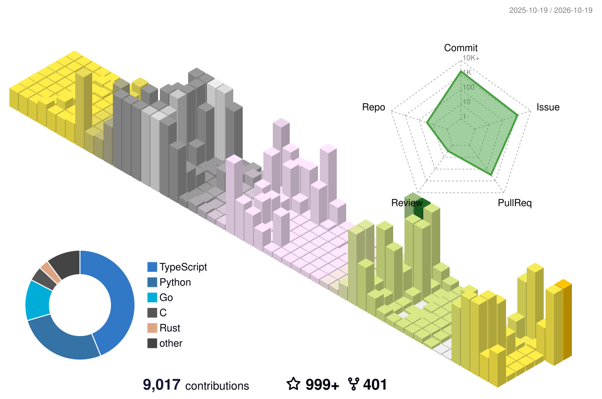

<!-- Header with Wave Animation -->

<!-- Typing Animation -->

  

  
  
  
  
  

<!-- Stats Counter Badges - Moved to Top -->

  
  
  
  

---

## About Me

Systems Programmer deeply passionate about low-level engineering, performance optimization, and building robust system architectures from the ground up.

- Currently building experimental system software
- Deep diving into Compiler design and experimental OS kernels
- Ask me about Operating Systems, Kernel Internals, MLOps, HPC
- Fun fact: I spend more time with binary dumps than people

---

## Tech Stack

  

---

## GitHub Analytics

<!-- GitHub Stats Grid - Better Alignment -->

  <table>
    <tr>
      <td align="center">
        
      </td>
      <td align="center">
        
      </td>
    </tr>
    <tr>
      <td align="center">
        
      </td>
      <td align="center">
        
      </td>
    </tr>
  </table>

 

<!-- GitHub Streak Stats -->

  

 

<!-- Profile Details Card - Full Width -->

  

 

<!-- Activity Graph - Collapsible -->

  
<h3>📈 GitHub Activity Graph (Click to Expand)</h3>

  

    
  

 

<!-- Detailed GitHub Stats - Collapsible -->

  
<h3>📊 Detailed GitHub Statistics (Click to Expand)</h3>

  

    
  

---

## Lines of Code Statistics

<!--START_LOC-->
<!--END_LOC-->

---

## 3D Contribution Graph

  

---

## Contribution Snake

  

---

## Latest Blog Posts

<!-- BLOG-POST-LIST:START -->
- [AWS ME-CENTRAL-1 and ME-SOUTH-1: When War Came to the Cloud](https://mohitmishra786.github.io/TheCoreDump/posts/AWS-ME-CENTRAL1-Bahrain-Military-Strike-Outage-When-War-Came-to-the-Cloud/)
- [Cloudflare BYOIP BGP Withdrawal: When an Automated Script Erases Your Addresses](https://mohitmishra786.github.io/TheCoreDump/posts/Cloudflare-BYOIP-BGP-Withdrawal-When-an-Automated-Script-Erases-Your-Addresses/)
- [YouTube February 2026: When the Recommendation Engine Is the Product](https://mohitmishra786.github.io/TheCoreDump/posts/YouTube-February-2026-When-the-Recommendation-Engine-Is-the-Product/)
- [Root Cause Analysis: GitHub&#39;s February 2026 Service Disruptions](https://mohitmishra786.github.io/TheCoreDump/posts/Root-Cause-Analysis-GitHub's-February-2026-Service-Disruptions/)
- [AWS CloudFront DNS Failure: One CDN Layer, Twenty Platforms, Zero Warning](https://mohitmishra786.github.io/TheCoreDump/posts/AWS-CloudFront-DNS-Failure-One-CDN-Layer-Twenty-Platforms-Zero-Warning/)<!-- BLOG-POST-LIST:END -->

<!-- LOC-STATS-START -->

**Last Updated:** 2026-10-17 02:31:29 UTC

 Detailed Statistics

# LOC Statistics - All Repositories

Generated on: 2026-10-17 02:25:49 UTC

## Summary Statistics

| Metric | Count |
|--------|-------|
| Total Repositories Processed | 115 |
| Failed Repositories | 45 |
| Total Files | 98,819 |
| Total Lines of Code | 40,052,572 |
| Total Blank Lines | 8,490,795 |
| Total Comment Lines | 2,978,700 |

## Top 15 Languages by LOC

| Language | Files | Code Lines | Comment Lines | Blank Lines |
|----------|-------|------------|---------------|-------------|
| Jupyter Notebook |    367 |    2021072 |       2021072 |           0 |
| C            |  20508 |     420227 |        420227 |      901657 |
| C++          |  26207 |     172811 |        172811 |     2799559 |
| HTML         |   1549 |      84173 |         84173 |      310109 |
| C/C++ Header |    447 |      64048 |         64048 |       30019 |
| TypeScript   |   1053 |      51130 |         51130 |       18525 |
| JavaScript   |   1518 |      45969 |         45969 |       24028 |
| Python       |   1266 |      35177 |         35177 |       38147 |
| Ruby         |   1346 |      33098 |         33098 |       23077 |
| reStructuredText |     27 |      16785 |         16785 |        6004 |
| Go           |    528 |       8627 |          8627 |       15575 |
| Assembly     |     57 |       5267 |          5267 |        2616 |
| Java         |     66 |       4090 |          4090 |        1712 |
| YAML         |    543 |       2660 |          2660 |        4871 |
| Bourne Shell |    132 |       2417 |          2417 |        1525 |

## Top 20 Repositories by LOC

| Repository | Lines of Code |
|------------|---------------|
| mohitmishra786/compiler                            |      32231077 |
| OmdenaAI/Berlin-Chapter-Challenge-Waste-Management |       2979527 |
| mohitmishra786/meshery                             |       1650694 |
| OmdenaAI/dhaka-bangladesh-real-estate-recommendation |        477093 |
| OmdenaAI/omdena-texas-homelessness                 |        404748 |
| mohitmishra786/Homelessness-in-Texas               |        404740 |
| mohitmishra786/chessman                            |        290280 |
| mohitmishra786/REST-API                            |        208637 |
| mohitmishra786/Sales_Data_Analysis                 |        186979 |
| mohitmishra786/Of-Genomes-And-Genetics---HackerEarth-ML |        116724 |
| OmdenaAI/lagos-chapter-water-availability          |        101722 |
| mohitmishra786/confscout                           |         69176 |
| mohitmishra786/aurora-dev                          |         58044 |
| mohitmishra786/matchquill                          |         55707 |
| mohitmishra786/ML-and-DL                           |         52977 |
| mohitmishra786/mdmend                              |         41001 |
| mohitmishra786/readprism                           |         35273 |
| mohitmishra786/mohit-portfolio                     |         31091 |
| mohitmishra786/low-level-dev-skills                |         30606 |
| mohitmishra786/EddieBot                            |         30296 |

<!-- LOC-STATS-END -->
