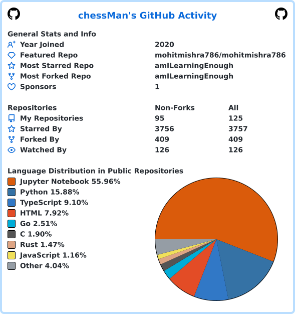

<!-- Banner (the one visual accent). capsule-render's gradient + white text reads on light and dark themes. -->

  

  <b>Systems programmer.</b> I write guides and build tools around operating systems, compilers, ELF binaries and reverse engineering, 
  and contribute fixes to the <a href="https://github.com/edgcpp/compiler">EDG C/C++ compiler front end</a> and <a href="https://github.com/sched-ext/scx">sched_ext Linux schedulers</a>.

  
  
  
  
  
  

## What I'm building

| Project | What it is | Stars |
|---|---|---:|
| [amILearningEnough](https://github.com/mohitmishra786/amILearningEnough) | Low-level programming roadmap and curated resources ([site](https://mohitmishra786.github.io/amILearningEnough/)) |  |
| [reversingBits](https://github.com/mohitmishra786/reversingBits) | Cheatsheets for reverse engineering, binary analysis and assembly tooling ([site](https://mohitmishra786.github.io/reversingBits/)) |  |
| [underTheHoodOfExecutables](https://github.com/mohitmishra786/underTheHoodOfExecutables) | How source becomes an executable: ELF, linking and binary optimization ([site](https://mohitmishra786.github.io/underTheHoodOfExecutables/)) |  |
| [exploring-os](https://github.com/mohitmishra786/exploring-os) | Operating-system concepts, one topic a day, with implementations in C ([site](https://mohitmishra786.github.io/exploring-os/)) |  |
| [myJourneyOfBuildingOS](https://github.com/mohitmishra786/myJourneyOfBuildingOS) | Book in progress on building an OS from scratch, in C ([site](https://mohitmishra786.github.io/myJourneyOfBuildingOS/)) |  |
| [low-level-dev-skills](https://github.com/mohitmishra786/low-level-dev-skills) | AI agent skills for C/C++, Rust and Zig toolchains: compilers, debuggers, profilers, sanitizers ([site](https://www.lowleveldevskills.com)) |  |
| [implement-from-scratch](https://github.com/implement-from-scratch) | My org of from-scratch guides and C implementations: Unix shell, thread-safe memory allocator, ls, TCP server ([site](https://website-seven-murex-43.vercel.app)) |  |

## Featured open-source contributions

<!-- FEATURED-CONTRIBUTIONS:START -->
| Repository | What I worked on | Merged PRs | Stars |
|---|---|---:|---:|
| [sched-ext/scx](https://github.com/sched-ext/scx) | scx\_mlfq fix for RT drain on not-yet-created DSQs; README kernel-config note | [4](https://github.com/sched-ext/scx/pulls?q=is%3Apr%20is%3Amerged%20author%3Amohitmishra786) | 2.3k |
| [Seafoam-Labs/Shelly-ALPM](https://github.com/Seafoam-Labs/Shelly-ALPM) | Keep pacman progress bar pellets in place | [3](https://github.com/Seafoam-Labs/Shelly-ALPM/pulls?q=is%3Apr%20is%3Amerged%20author%3Amohitmishra786) | 1.3k |
| [edgcpp/compiler](https://github.com/edgcpp/compiler) | C++ front-end fixes: auto deduction from void, 128-bit integer limits, \<meta\>/reflection | [7](https://github.com/edgcpp/compiler/pulls?q=is%3Apr%20is%3Amerged%20author%3Amohitmishra786) | 1k |
| [AmadeusITGroup/ai-primitives-hub](https://github.com/AmadeusITGroup/ai-primitives-hub) | fix\(cli\): report failed bundles in the interactive hub install | [5](https://github.com/AmadeusITGroup/ai-primitives-hub/pulls?q=is%3Apr%20is%3Amerged%20author%3Amohitmishra786) | 52 |
| [sched-ext/scx-loader](https://github.com/sched-ext/scx-loader) | Removed leftover scxtui references from README and scxctl | [1](https://github.com/sched-ext/scx-loader/pulls?q=is%3Apr%20is%3Amerged%20author%3Amohitmishra786) | 49 |
| [perses/plugins](https://github.com/perses/plugins) | \[BUGFIX\] table: migrate thresholds whose base step has no value | [1](https://github.com/perses/plugins/pulls?q=is%3Apr%20is%3Amerged%20author%3Amohitmishra786) | 34 |
| [OmdenaAI/omdena-colombia-career-recommender-system](https://github.com/OmdenaAI/omdena-colombia-career-recommender-system) | EDA notebook and template | [7](https://github.com/OmdenaAI/omdena-colombia-career-recommender-system/pulls?q=is%3Apr%20is%3Amerged%20author%3Amohitmishra786) | 12 |
| [OmdenaAI/omdena-texas-homelessness](https://github.com/OmdenaAI/omdena-texas-homelessness) | EDA notebooks, dashboards and a web app page | [36](https://github.com/OmdenaAI/omdena-texas-homelessness/pulls?q=is%3Apr%20is%3Amerged%20author%3Amohitmishra786) | 11 |
<!-- FEATURED-CONTRIBUTIONS:END -->

Merged PRs into public repositories I don't own, refreshed every 6 hours by <a href=".github/workflows/recent-activity.yml">recent-activity.yml</a> (data: <a href="contributions.json">contributions.json</a>).

## Recently merged PRs

<!-- RECENT-PRS:START -->
- [sched-ext/scx#3968](https://github.com/sched-ext/scx/pull/3968): lib: Drop the unused page fragment allocator, merged 2026-11-21
- [perses/plugins#952](https://github.com/perses/plugins/pull/952): \[BUGFIX\] table: migrate thresholds whose base step has no value, merged 2026-11-20
- [AmadeusITGroup/ai-primitives-hub#707](https://github.com/AmadeusITGroup/ai-primitives-hub/pull/707): fix\(cli\): report failed bundles in the interactive hub install, merged 2026-11-20
- [AmadeusITGroup/ai-primitives-hub#703](https://github.com/AmadeusITGroup/ai-primitives-hub/pull/703): fix\(cli\): report interactive hub install failures instead of crashing, merged 2026-11-20
- [edgcpp/compiler#547](https://github.com/edgcpp/compiler/pull/547): Keep needed parentheses around co\_await and co\_yield in generated C++. \[GH \#546\], merged 2026-11-20
<!-- RECENT-PRS:END -->

<b>Open PRs</b>

<!-- OPEN-PRS:START -->
- [systemd/systemd#44957](https://github.com/systemd/systemd/pull/44957): core: set $LISTEN\_PIDFDID in the payload process with PrivatePIDs=, opened 2026-11-21
- [perses/plugins#954](https://github.com/perses/plugins/pull/954): \[BUGFIX\] TimeSeriesChart: match byName overrides exactly in the migration, opened 2026-11-20
- [winsw/winsw#1532](https://github.com/winsw/winsw/pull/1532): v2 - Publish release binaries with their usual file names, opened 2026-11-20
- [perses/perses#4784](https://github.com/perses/perses/pull/4784): \[BUGFIX\] Return a 400 for a datasource proxy without spec, opened 2026-11-20
- [perses/helm-charts#268](https://github.com/perses/helm-charts/pull/268): \[BUGFIX\] perses: keep the Secret key of an empty client\_secret, opened 2026-11-20
<!-- OPEN-PRS:END -->

<b>Recently merged into my own repos</b>

<!-- RECENT-OWN-MERGES:START -->
- [mohitmishra786/mohitmishra786#61](https://github.com/mohitmishra786/mohitmishra786/pull/61): Use GH\_PAT for the gh search steps, merged 2026-11-21
- [mohitmishra786/mohitmishra786#60](https://github.com/mohitmishra786/mohitmishra786/pull/60): Retry failed gh calls in contributions.py, merged 2026-11-21
- [mohitmishra786/portfolio#18](https://github.com/mohitmishra786/portfolio/pull/18): feat: show PRs and issues in other projects on open source page, merged 2026-11-20
- [mohitmishra786/low-level-dev-skills#35](https://github.com/mohitmishra786/low-level-dev-skills/pull/35): Add tracing-profilers skill \(Perfetto, Tracy\), merged 2026-11-20
- [mohitmishra786/low-level-dev-skills#33](https://github.com/mohitmishra786/low-level-dev-skills/pull/33): Add riscv-vector skill, merged 2026-11-20
<!-- RECENT-OWN-MERGES:END -->

## Issues I've reported

<!-- OPEN-ISSUES:START -->
- [perses/perses#4786](https://github.com/perses/perses/issues/4786): Grafana migration: TimeSeriesChart byName overrides are matched as a regexp, opened 2026-11-20
- [winsw/winsw#1533](https://github.com/winsw/winsw/issues/1533): restart\! fails with Access is denied for non-administrator service accounts, opened 2026-11-20
- [perses/perses#4783](https://github.com/perses/perses/issues/4783): Datasource with a null or missing proxy spec returns HTTP 500, opened 2026-11-20
- [sched-ext/scx#4001](https://github.com/sched-ext/scx/issues/4001): scx\_rusty: sdt\_free\_idx\(\) never zeroes freed task\_ctx slots, opened 2026-11-19
- [sched-ext/scx#3999](https://github.com/sched-ext/scx/issues/3999): scx\_rusty: load balancer reads scx\_bpf\_now\(\) timestamps against CLOCK\_MONOTONIC, opened 2026-11-18
<!-- OPEN-ISSUES:END -->

<b>Recently closed</b>

<!-- CLOSED-ISSUES:START -->
- [perses/perses#4785](https://github.com/perses/perses/issues/4785): Grafana migration: Table panel fails when a threshold step has no value, resolved 2026-11-20
- [christianalfoni/webpack-express-boilerplate#86](https://github.com/christianalfoni/webpack-express-boilerplate/issues/86): \[Feature\] : Test to run on CI \(Github Actions\), resolved 2026-11-20
- [the-full-stack/course-gitbook#12](https://github.com/the-full-stack/course-gitbook/issues/12): Site Taking Too Long to Respond, resolved 2026-11-20
- [JRavi2/Chat-Analyzer#7](https://github.com/JRavi2/Chat-Analyzer/issues/7): Determining the incentive of chats, resolved 2026-11-20
- [arpeggi-15/Flight-Fare-Prediction#20](https://github.com/arpeggi-15/Flight-Fare-Prediction/issues/20): I want to use multiple algorithms and work over the data, resolved 2026-11-20
<!-- CLOSED-ISSUES:END -->

<b>Open in my own repos</b>

<!-- OWN-OPEN-ISSUES:START -->
- [mohitmishra786/low-level-dev-skills#36](https://github.com/mohitmishra786/low-level-dev-skills/issues/36): Coverage follow-up: Intel PT/record-replay, CXL, gccrs, opened 2026-11-20
- [mohitmishra786/portfolio#17](https://github.com/mohitmishra786/portfolio/issues/17): Update project links from deleted forks to upstream OmdenaAI repos, opened 2026-10-25
- [mohitmishra786/single-page-portfolio#2](https://github.com/mohitmishra786/single-page-portfolio/issues/2): Update project links from deleted forks to upstream OmdenaAI repos, opened 2026-10-25
- [mohitmishra786/mohit-portfolio#49](https://github.com/mohitmishra786/mohit-portfolio/issues/49): Update project links from deleted forks to upstream OmdenaAI repos, opened 2026-10-25
- [mohitmishra786/weirling#342](https://github.com/mohitmishra786/weirling/issues/342): \[P3\] Billing: add Razorpay as a second provider, opened 2026-10-20
<!-- OWN-OPEN-ISSUES:END -->

## Latest blog posts

<!-- BLOG-POST-LIST:START -->
- [AWS ME-CENTRAL-1 and ME-SOUTH-1: When War Came to the Cloud](https://mohitmishra786.github.io/TheCoreDump/posts/AWS-ME-CENTRAL1-Bahrain-Military-Strike-Outage-When-War-Came-to-the-Cloud/)
- [Cloudflare BYOIP BGP Withdrawal: When an Automated Script Erases Your Addresses](https://mohitmishra786.github.io/TheCoreDump/posts/Cloudflare-BYOIP-BGP-Withdrawal-When-an-Automated-Script-Erases-Your-Addresses/)
- [YouTube February 2026: When the Recommendation Engine Is the Product](https://mohitmishra786.github.io/TheCoreDump/posts/YouTube-February-2026-When-the-Recommendation-Engine-Is-the-Product/)
- [Root Cause Analysis: GitHub&#39;s February 2026 Service Disruptions](https://mohitmishra786.github.io/TheCoreDump/posts/Root-Cause-Analysis-GitHub's-February-2026-Service-Disruptions/)
- [AWS CloudFront DNS Failure: One CDN Layer, Twenty Platforms, Zero Warning](https://mohitmishra786.github.io/TheCoreDump/posts/AWS-CloudFront-DNS-Failure-One-CDN-Layer-Twenty-Platforms-Zero-Warning/)<!-- BLOG-POST-LIST:END -->

## Tech I use

  <picture>
    <source media="(prefers-color-scheme: dark)" srcset="https://skillicons.dev/icons?i=c%2Ccpp%2Crust%2Cgo%2Czig%2Cpython%2Cts%2Cbash%2Clinux%2Cdocker%2Cgit%2Cgithubactions&theme=dark" />
    <source media="(prefers-color-scheme: light)" srcset="https://skillicons.dev/icons?i=c%2Ccpp%2Crust%2Cgo%2Czig%2Cpython%2Cts%2Cbash%2Clinux%2Cdocker%2Cgit%2Cgithubactions&theme=light" />
    
  </picture>

## Stats

<b>GitHub statistics and lines of code</b> (self-hosted, regenerated daily)

  <picture>
    <source media="(prefers-color-scheme: dark)" srcset="assets/github-user-stats-dark.svg" />
    <source media="(prefers-color-scheme: light)" srcset="assets/github-user-stats.svg" />
    
  </picture>

<!-- LOC-STATS-START -->
 

Lines-of-code details

_As of 2026-11-21. Counts own public, non-fork, non-archived repositories (cloc, excluding data/docs formats and vendored/build directories)._

| Metric | Count |
|--------|------:|
| Repositories counted | 81 |
| Empty repositories skipped | 5 |
| Failed repositories | 0 |
| Files | 3,664 |
| Code lines | 443,631 |
| Comment lines | 146,139 |
| Blank lines | 77,360 |

**Top 15 languages by code lines**

| Language | Files | Code | Comment | Blank |
|----------|------:|-----:|--------:|------:|
| Python | 1,173 | 128,655 | 29,612 | 33,504 |
| TypeScript | 837 | 88,699 | 7,796 | 12,491 |
| HTML | 118 | 53,170 | 158 | 1,040 |
| Go | 212 | 33,856 | 1,165 | 4,670 |
| CSS | 54 | 31,070 | 644 | 3,632 |
| C | 237 | 20,540 | 1,699 | 4,499 |
| YAML | 211 | 17,241 | 1,013 | 3,183 |
| Rust | 68 | 15,337 | 1,539 | 1,432 |
| C++ | 262 | 12,954 | 1,617 | 2,348 |
| JavaScript | 142 | 10,339 | 1,259 | 1,589 |
| Swift | 51 | 8,251 | 1,938 | 2,347 |
| Jupyter Notebook | 42 | 6,011 | 95,595 | 0 |
| SWIG | 3 | 3,765 | 0 | 3,766 |
| Bourne Shell | 53 | 3,305 | 484 | 804 |
| Assembly | 8 | 1,677 | 149 | 221 |

**Top 20 repositories by code lines**

| Repository | Code |
|------------|-----:|
| [mohitmishra786/weirling](https://github.com/mohitmishra786/weirling) | 56,840 |
| [mohitmishra786/Of-Genomes-And-Genetics---HackerEarth-ML](https://github.com/mohitmishra786/Of-Genomes-And-Genetics---HackerEarth-ML) | 43,894 |
| [mohitmishra786/matchquill](https://github.com/mohitmishra786/matchquill) | 39,245 |
| [mohitmishra786/aurora-dev](https://github.com/mohitmishra786/aurora-dev) | 27,636 |
| [mohitmishra786/mohit-portfolio](https://github.com/mohitmishra786/mohit-portfolio) | 21,802 |
| [mohitmishra786/mdmend](https://github.com/mohitmishra786/mdmend) | 18,223 |
| [mohitmishra786/confscout](https://github.com/mohitmishra786/confscout) | 17,694 |
| [mohitmishra786/undertow](https://github.com/mohitmishra786/undertow) | 16,335 |
| [mohitmishra786/BitsAndBytes](https://github.com/mohitmishra786/BitsAndBytes) | 14,927 |
| [mohitmishra786/neuro-code](https://github.com/mohitmishra786/neuro-code) | 14,656 |
| [mohitmishra786/vislab](https://github.com/mohitmishra786/vislab) | 14,214 |
| [mohitmishra786/writ](https://github.com/mohitmishra786/writ) | 12,880 |
| [mohitmishra786/hacktoberfest-2022](https://github.com/mohitmishra786/hacktoberfest-2022) | 11,565 |
| [mohitmishra786/yt-setup](https://github.com/mohitmishra786/yt-setup) | 9,642 |
| [mohitmishra786/control](https://github.com/mohitmishra786/control) | 8,818 |
| [mohitmishra786/agentop](https://github.com/mohitmishra786/agentop) | 8,738 |
| [mohitmishra786/myJourneyOfBuildingOS](https://github.com/mohitmishra786/myJourneyOfBuildingOS) | 8,627 |
| [mohitmishra786/postgres-hackers-explorer](https://github.com/mohitmishra786/postgres-hackers-explorer) | 7,630 |
| [mohitmishra786/repo2video](https://github.com/mohitmishra786/repo2video) | 6,997 |
| [mohitmishra786/never](https://github.com/mohitmishra786/never) | 6,610 |

**Lines changed in my 67 merged PRs to other people's public repos**: +20,332 / -1,828 _(from the PR file diffs; data, docs, lockfiles and notebooks excluded)_

| Language | Added | Removed |
|----------|------:|--------:|
| Python | 10,732 | 181 |
| Dart | 2,431 | 1,008 |
| Other | 2,245 | 100 |
| TypeScript | 1,922 | 130 |
| YAML | 1,171 | 7 |
| C++ | 551 | 2 |
| C | 323 | 78 |
| Java | 291 | 0 |
| Go | 189 | 214 |
| Zig | 166 | 20 |

<!-- LOC-STATS-END -->

  <picture>
    <source media="(prefers-color-scheme: dark)" srcset="assets/github-snake-dark.svg" />
    <source media="(prefers-color-scheme: light)" srcset="assets/github-snake.svg" />
    
  </picture>

  

