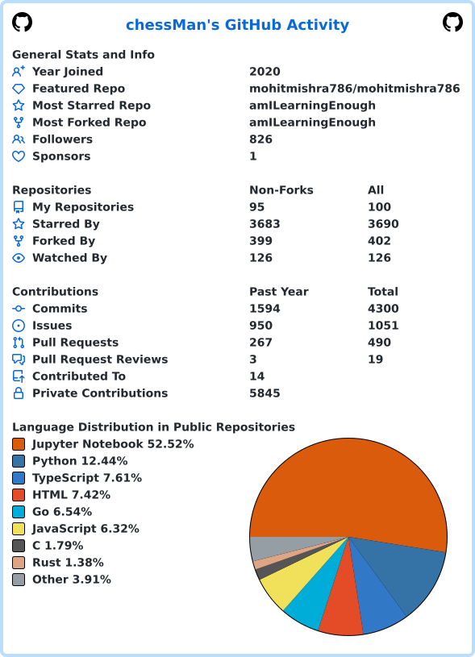

<!-- Banner (the one visual accent). capsule-render's gradient + white text reads on light and dark themes. -->

  

  <b>Systems programmer.</b> I write guides and build tools around operating systems, compilers, ELF binaries and reverse engineering, 
  and contribute fixes to the <a href="https://github.com/edgcpp/compiler">EDG C/C++ compiler front end</a> and <a href="https://github.com/sched-ext/scx">sched_ext Linux schedulers</a>.

  
  
  
  
  
  

## What I'm building

| Project | What it is | Stars |
|---|---|---:|
| [amILearningEnough](https://github.com/mohitmishra786/amILearningEnough) | Low-level programming roadmap and curated resources ([site](https://mohitmishra786.github.io/amILearningEnough/)) |  |
| [reversingBits](https://github.com/mohitmishra786/reversingBits) | Cheatsheets for reverse engineering, binary analysis and assembly tooling ([site](https://mohitmishra786.github.io/reversingBits/)) |  |
| [underTheHoodOfExecutables](https://github.com/mohitmishra786/underTheHoodOfExecutables) | How source becomes an executable: ELF, linking and binary optimization ([site](https://mohitmishra786.github.io/underTheHoodOfExecutables/)) |  |
| [exploring-os](https://github.com/mohitmishra786/exploring-os) | Operating-system concepts, one topic a day, with implementations in C ([site](https://mohitmishra786.github.io/exploring-os/)) |  |
| [myJourneyOfBuildingOS](https://github.com/mohitmishra786/myJourneyOfBuildingOS) | Book in progress on building an OS from scratch, in C ([site](https://mohitmishra786.github.io/myJourneyOfBuildingOS/)) |  |
| [low-level-dev-skills](https://github.com/mohitmishra786/low-level-dev-skills) | AI agent skills for C/C++, Rust and Zig toolchains: compilers, debuggers, profilers, sanitizers ([site](https://www.lowleveldevskills.com)) |  |
| [implement-from-scratch](https://github.com/implement-from-scratch) | My org of from-scratch guides and C implementations: Unix shell, thread-safe memory allocator, ls, TCP server ([site](https://website-seven-murex-43.vercel.app)) |  |

## Featured open-source contributions

<!-- FEATURED-CONTRIBUTIONS:START -->
| Repository | What I worked on | Merged PRs | Stars |
|---|---|---:|---:|
| [sched-ext/scx](https://github.com/sched-ext/scx) | scx\_mlfq fix for RT drain on not-yet-created DSQs; README kernel-config note | [2](https://github.com/sched-ext/scx/pulls?q=is%3Apr%20is%3Amerged%20author%3Amohitmishra786) | 2.2k |
| [edgcpp/compiler](https://github.com/edgcpp/compiler) | C++ front-end fixes: auto deduction from void, 128-bit integer limits, \<meta\>/reflection | [3](https://github.com/edgcpp/compiler/pulls?q=is%3Apr%20is%3Amerged%20author%3Amohitmishra786) | 987 |
| [sched-ext/scx-loader](https://github.com/sched-ext/scx-loader) | Removed leftover scxtui references from README and scxctl | [1](https://github.com/sched-ext/scx-loader/pulls?q=is%3Apr%20is%3Amerged%20author%3Amohitmishra786) | 44 |
| [OmdenaAI/omdena-colombia-career-recommender-system](https://github.com/OmdenaAI/omdena-colombia-career-recommender-system) | EDA notebook and template | [7](https://github.com/OmdenaAI/omdena-colombia-career-recommender-system/pulls?q=is%3Apr%20is%3Amerged%20author%3Amohitmishra786) | 12 |
| [OmdenaAI/omdena-texas-homelessness](https://github.com/OmdenaAI/omdena-texas-homelessness) | EDA notebooks, dashboards and a web app page | [36](https://github.com/OmdenaAI/omdena-texas-homelessness/pulls?q=is%3Apr%20is%3Amerged%20author%3Amohitmishra786) | 11 |
| [OmdenaAI/omdena-srilanka-tea-quality](https://github.com/OmdenaAI/omdena-srilanka-tea-quality) | Azure ML pipeline and repo restructuring | [11](https://github.com/OmdenaAI/omdena-srilanka-tea-quality/pulls?q=is%3Apr%20is%3Amerged%20author%3Amohitmishra786) | 10 |
| [chrinovicmu/netHex](https://github.com/chrinovicmu/netHex) | Code-quality fixes for the issues I reported in \#2 | [1](https://github.com/chrinovicmu/netHex/pulls?q=is%3Apr%20is%3Amerged%20author%3Amohitmishra786) | 6 |
| [OmdenaAI/sao-paulo-brazil-plant-diseases](https://github.com/OmdenaAI/sao-paulo-brazil-plant-diseases) | Dataset folder and Task-2 data-collection README | [2](https://github.com/OmdenaAI/sao-paulo-brazil-plant-diseases/pulls?q=is%3Apr%20is%3Amerged%20author%3Amohitmishra786) | 6 |
<!-- FEATURED-CONTRIBUTIONS:END -->

Merged PRs into public repositories I don't own, refreshed every 6 hours by <a href=".github/workflows/recent-activity.yml">recent-activity.yml</a> (data: <a href="contributions.json">contributions.json</a>).

## Recently merged PRs

<!-- RECENT-PRS:START -->
- [sched-ext/scx#3934](https://github.com/sched-ext/scx/pull/3934): scx\_mlfq: Skip the RT drain on queue DSQs that don't exist yet, merged 2026-10-25
- [sched-ext/scx-loader#80](https://github.com/sched-ext/scx-loader/pull/80): README, scxctl: Drop leftover scxtui references, merged 2026-10-25
- [sched-ext/scx#3933](https://github.com/sched-ext/scx/pull/3933): README: List CONFIG\_KALLSYMS\_ALL as a required kernel option, merged 2026-10-25
- [edgcpp/compiler#343](https://github.com/edgcpp/compiler/pull/343): move \<meta\> out of include\_c++/experimental and define \_\_cpp\_lib\_reflection, fix for…, merged 2026-10-23
- [edgcpp/compiler#265](https://github.com/edgcpp/compiler/pull/265): default integer value limits to 128 bits with \_\_int128 extensions, fix for \[GH \#38\], merged 2026-10-21
<!-- RECENT-PRS:END -->

<b>Open PRs</b>

<!-- OPEN-PRS:START -->
- [sched-ext/scx-loader#81](https://github.com/sched-ext/scx-loader/pull/81): scx\_loader: Allow custom schedulers defined in the config, opened 2026-10-25
- [Seafoam-Labs/Shelly-ALPM#2102](https://github.com/Seafoam-Labs/Shelly-ALPM/pull/2102): Keep pacman progress bar pellets in place, opened 2026-10-25
- [Seafoam-Labs/Shelly-ALPM#2101](https://github.com/Seafoam-Labs/Shelly-ALPM/pull/2101): Keep included IgnorePkg entries out of pacman.conf, opened 2026-10-25
- [Seafoam-Labs/Shelly-ALPM#2100](https://github.com/Seafoam-Labs/Shelly-ALPM/pull/2100): Collapse whitespace in wrapped pkgdesc when writing .PKGINFO, opened 2026-10-25
- [sched-ext/scx#3936](https://github.com/sched-ext/scx/pull/3936): scx\_rusty: Don't move tasks that leave the imbalance unchanged, opened 2026-10-25
<!-- OPEN-PRS:END -->

<b>Recently merged into my own repos</b>

<!-- RECENT-OWN-MERGES:START -->
- [mohitmishra786/weirling#386](https://github.com/mohitmishra786/weirling/pull/386): v0.3.5: rank against every interest, no pack-name topics, per-reader emerging, merged 2026-10-25
- [mohitmishra786/weirling#385](https://github.com/mohitmishra786/weirling/pull/385): v0.3.4: Claude first with Groq fallback, distinct starter packs, better discovery and…, merged 2026-10-25
- [mohitmishra786/weirling#384](https://github.com/mohitmishra786/weirling/pull/384): Laptop and phone layout: wider app, phone menu, Interests panel on screen, merged 2026-10-25
- [mohitmishra786/weirling#383](https://github.com/mohitmishra786/weirling/pull/383): Revert \#382: remove Vercel Speed Insights until there is traffic to measure, merged 2026-10-25
- [mohitmishra786/mohitmishra786#58](https://github.com/mohitmishra786/mohitmishra786/pull/58): Fix tech-stack icons; treat implement-from-scratch as own org; drop EddieBot, merged 2026-10-25
<!-- RECENT-OWN-MERGES:END -->

## Latest blog posts

<!-- BLOG-POST-LIST:START -->
- [AWS ME-CENTRAL-1 and ME-SOUTH-1: When War Came to the Cloud](https://mohitmishra786.github.io/TheCoreDump/posts/AWS-ME-CENTRAL1-Bahrain-Military-Strike-Outage-When-War-Came-to-the-Cloud/)
- [Cloudflare BYOIP BGP Withdrawal: When an Automated Script Erases Your Addresses](https://mohitmishra786.github.io/TheCoreDump/posts/Cloudflare-BYOIP-BGP-Withdrawal-When-an-Automated-Script-Erases-Your-Addresses/)
- [YouTube February 2026: When the Recommendation Engine Is the Product](https://mohitmishra786.github.io/TheCoreDump/posts/YouTube-February-2026-When-the-Recommendation-Engine-Is-the-Product/)
- [Root Cause Analysis: GitHub&#39;s February 2026 Service Disruptions](https://mohitmishra786.github.io/TheCoreDump/posts/Root-Cause-Analysis-GitHub's-February-2026-Service-Disruptions/)
- [AWS CloudFront DNS Failure: One CDN Layer, Twenty Platforms, Zero Warning](https://mohitmishra786.github.io/TheCoreDump/posts/AWS-CloudFront-DNS-Failure-One-CDN-Layer-Twenty-Platforms-Zero-Warning/)<!-- BLOG-POST-LIST:END -->

## Tech I use

  <picture>
    <source media="(prefers-color-scheme: dark)" srcset="https://skillicons.dev/icons?i=c%2Ccpp%2Crust%2Cgo%2Czig%2Cpython%2Cts%2Cbash%2Clinux%2Cdocker%2Cgit%2Cgithubactions&theme=dark" />
    <source media="(prefers-color-scheme: light)" srcset="https://skillicons.dev/icons?i=c%2Ccpp%2Crust%2Cgo%2Czig%2Cpython%2Cts%2Cbash%2Clinux%2Cdocker%2Cgit%2Cgithubactions&theme=light" />
    
  </picture>

## Stats

<b>GitHub statistics and lines of code</b> (self-hosted, regenerated daily)

  <picture>
    <source media="(prefers-color-scheme: dark)" srcset="assets/github-user-stats-dark.svg" />
    <source media="(prefers-color-scheme: light)" srcset="assets/github-user-stats.svg" />
    
  </picture>

<!-- LOC-STATS-START -->
 

Lines-of-code details

_As of 2026-10-26. Counts own public, non-fork, non-archived repositories (cloc, excluding data/docs formats and vendored/build directories)._

| Metric | Count |
|--------|------:|
| Repositories counted | 81 |
| Empty repositories skipped | 5 |
| Failed repositories | 0 |
| Files | 3,653 |
| Code lines | 442,370 |
| Comment lines | 146,043 |
| Blank lines | 77,201 |

**Top 15 languages by code lines**

| Language | Files | Code | Comment | Blank |
|----------|------:|-----:|--------:|------:|
| Python | 1,172 | 128,488 | 29,595 | 33,476 |
| TypeScript | 835 | 88,382 | 7,775 | 12,459 |
| HTML | 118 | 53,170 | 158 | 1,040 |
| Go | 212 | 33,856 | 1,165 | 4,670 |
| CSS | 54 | 31,070 | 644 | 3,632 |
| C | 237 | 20,540 | 1,699 | 4,499 |
| YAML | 211 | 17,239 | 1,011 | 3,180 |
| Rust | 68 | 15,337 | 1,539 | 1,432 |
| C++ | 262 | 12,954 | 1,617 | 2,348 |
| JavaScript | 142 | 10,331 | 1,259 | 1,589 |
| Swift | 51 | 8,251 | 1,938 | 2,347 |
| Jupyter Notebook | 42 | 6,011 | 95,595 | 0 |
| SWIG | 3 | 3,765 | 0 | 3,766 |
| Bourne Shell | 53 | 3,305 | 484 | 804 |
| Assembly | 8 | 1,677 | 149 | 221 |

**Top 20 repositories by code lines**

| Repository | Code |
|------------|-----:|
| [mohitmishra786/weirling](https://github.com/mohitmishra786/weirling) | 56,759 |
| [mohitmishra786/Of-Genomes-And-Genetics---HackerEarth-ML](https://github.com/mohitmishra786/Of-Genomes-And-Genetics---HackerEarth-ML) | 43,894 |
| [mohitmishra786/matchquill](https://github.com/mohitmishra786/matchquill) | 38,953 |
| [mohitmishra786/aurora-dev](https://github.com/mohitmishra786/aurora-dev) | 27,636 |
| [mohitmishra786/mohit-portfolio](https://github.com/mohitmishra786/mohit-portfolio) | 21,802 |
| [mohitmishra786/mdmend](https://github.com/mohitmishra786/mdmend) | 18,223 |
| [mohitmishra786/confscout](https://github.com/mohitmishra786/confscout) | 17,575 |
| [mohitmishra786/undertow](https://github.com/mohitmishra786/undertow) | 16,335 |
| [mohitmishra786/BitsAndBytes](https://github.com/mohitmishra786/BitsAndBytes) | 14,927 |
| [mohitmishra786/neuro-code](https://github.com/mohitmishra786/neuro-code) | 14,656 |
| [mohitmishra786/vislab](https://github.com/mohitmishra786/vislab) | 13,842 |
| [mohitmishra786/writ](https://github.com/mohitmishra786/writ) | 12,880 |
| [mohitmishra786/hacktoberfest-2022](https://github.com/mohitmishra786/hacktoberfest-2022) | 11,565 |
| [mohitmishra786/yt-setup](https://github.com/mohitmishra786/yt-setup) | 9,642 |
| [mohitmishra786/control](https://github.com/mohitmishra786/control) | 8,818 |
| [mohitmishra786/agentop](https://github.com/mohitmishra786/agentop) | 8,738 |
| [mohitmishra786/myJourneyOfBuildingOS](https://github.com/mohitmishra786/myJourneyOfBuildingOS) | 8,627 |
| [mohitmishra786/postgres-hackers-explorer](https://github.com/mohitmishra786/postgres-hackers-explorer) | 7,630 |
| [mohitmishra786/repo2video](https://github.com/mohitmishra786/repo2video) | 6,997 |
| [mohitmishra786/never](https://github.com/mohitmishra786/never) | 6,610 |

**Lines changed in my 52 merged PRs to other people's public repos**: +17,578 / -1,578 _(from the PR file diffs; data, docs, lockfiles and notebooks excluded)_

| Language | Added | Removed |
|----------|------:|--------:|
| Python | 10,732 | 181 |
| Dart | 2,431 | 1,008 |
| Other | 2,243 | 93 |
| YAML | 1,171 | 7 |
| Java | 291 | 0 |
| Go | 189 | 214 |
| C | 118 | 47 |
| C++ | 118 | 2 |
| Shell | 116 | 2 |
| HTML | 110 | 0 |

<!-- LOC-STATS-END -->

  <picture>
    <source media="(prefers-color-scheme: dark)" srcset="assets/github-snake-dark.svg" />
    <source media="(prefers-color-scheme: light)" srcset="assets/github-snake.svg" />
    
  </picture>

  

